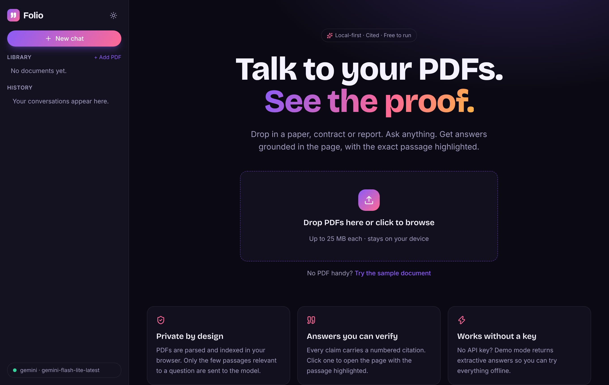
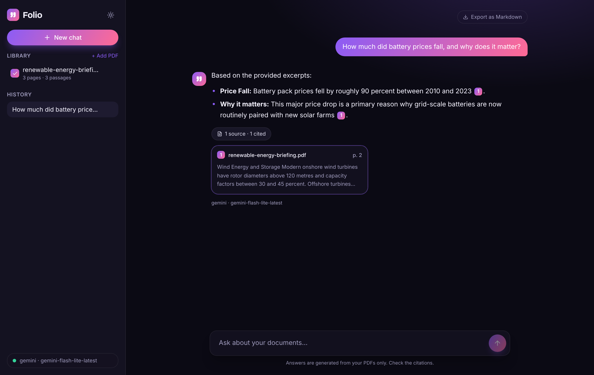
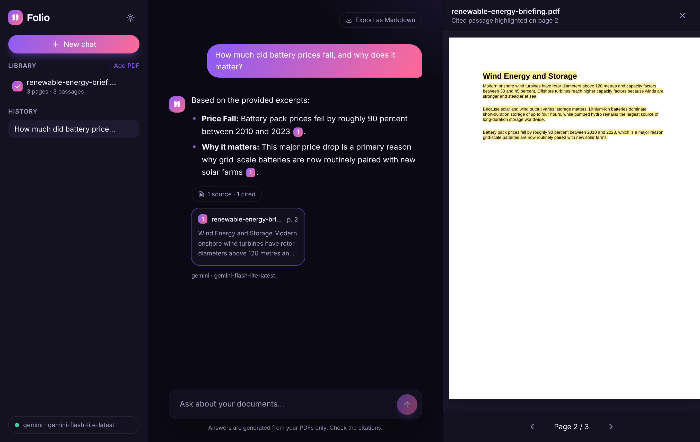
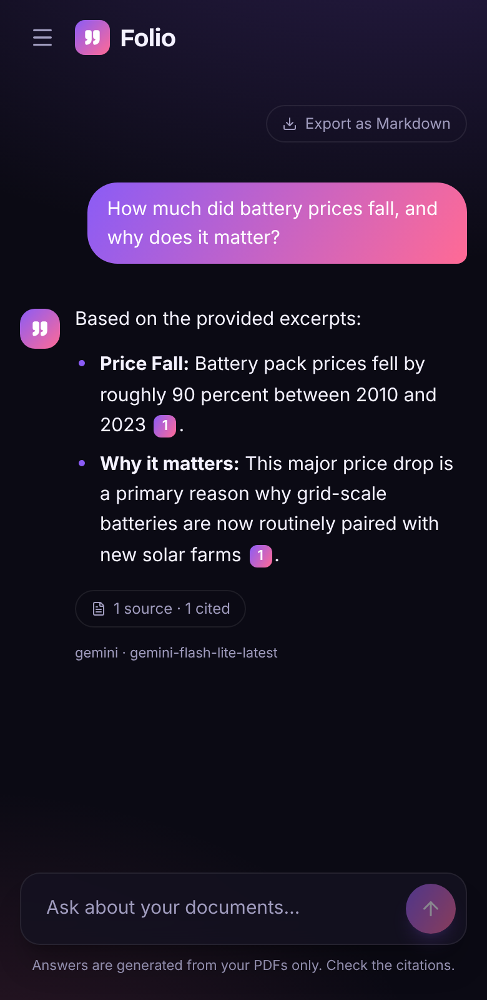
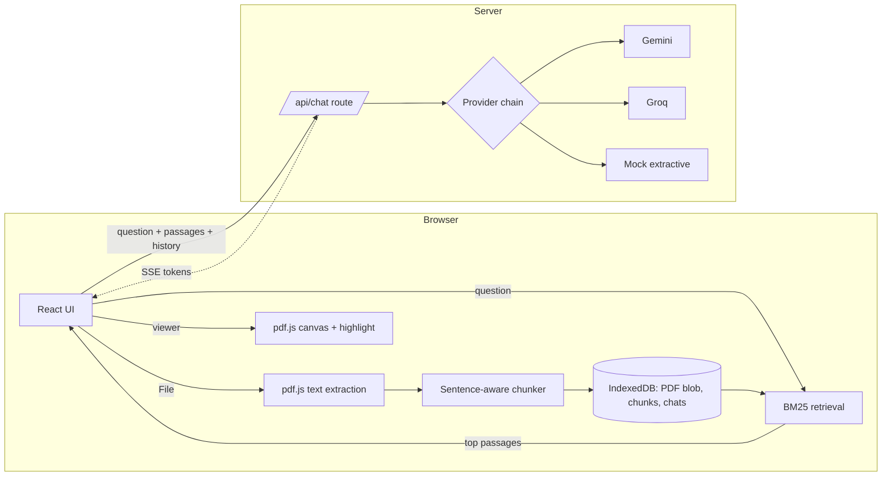

# Folio: chat with your PDFs, see the proof

> A private, local-first PDF chat app. Ask questions, get answers with numbered citations, and click any citation to open the exact page with the cited passage highlighted. Runs with **zero API keys** (demo mode) or on free Gemini / Groq keys.



| Cited answer | Source viewer with highlight |
| --- | --- |
|  |  |

<p align="center"></p>

## Features

- **Citations you can verify**: every claim carries `[n]`; clicking opens the PDF page with the passage highlighted.
- **Private by design**: PDFs are parsed, chunked and indexed in the browser (pdf.js + IndexedDB). Only the top few passages for a question are sent to the model.
- **Multi-document library**: toggle which PDFs a question searches.
- **Streaming answers** with a stop button, persisted chat history, Markdown export.
- **Hybrid-friendly retrieval**: BM25 with stemming, near-duplicate removal, follow-up query expansion and an overview mode for "summarize" questions.
- **Provider abstraction**: Gemini → Groq → mock fallback chain. No key = demo mode; a failing provider falls back automatically.
- Dark/light theme, drag-and-drop upload, loading/empty/error states, responsive down to phones.

## Tech stack

Next.js 15 (App Router) · React 19 · TypeScript (strict) · Tailwind CSS · pdf.js · idb-keyval · Vitest · Gemini / Groq REST APIs (no SDKs).

## Architecture



## Getting started

```bash
npm install
cp .env.example .env.local   # optional: add GEMINI_API_KEY and/or GROQ_API_KEY
npm run dev                  # http://localhost:3000
```

No keys? It starts in demo mode. Click **Try the sample document** to see everything working.

| Script | Purpose |
| --- | --- |
| `npm run dev` / `build` / `start` | Next.js |
| `npm run lint` · `typecheck` · `test` | Quality gates (also run in CI) |

See [developer.md](developer.md) for the audit, env vars, deployment and decisions, and [CHANGES.md](CHANGES.md) for a feature-by-feature walkthrough.

## Roadmap

- OCR for scanned PDFs (Tesseract.js)
- Optional embedding-based hybrid retrieval (Gemini embeddings)
- Shareable read-only chat exports
- Multi-column / table-aware extraction
